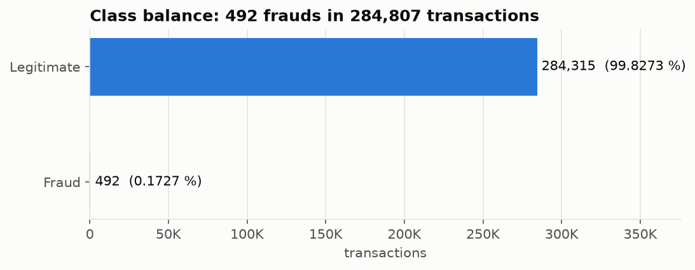
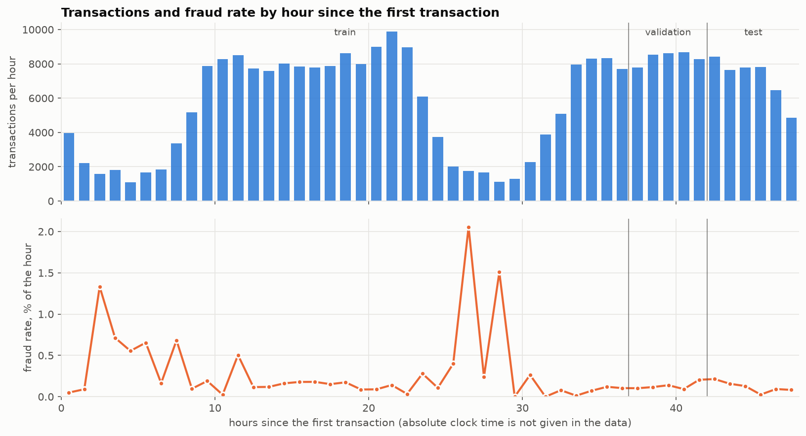
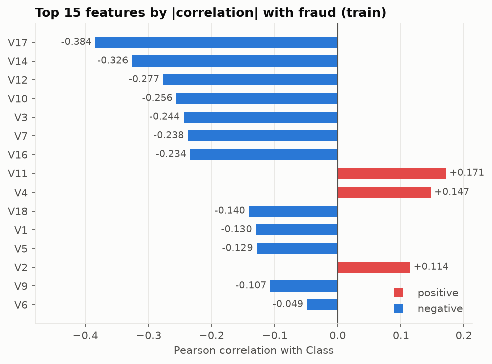
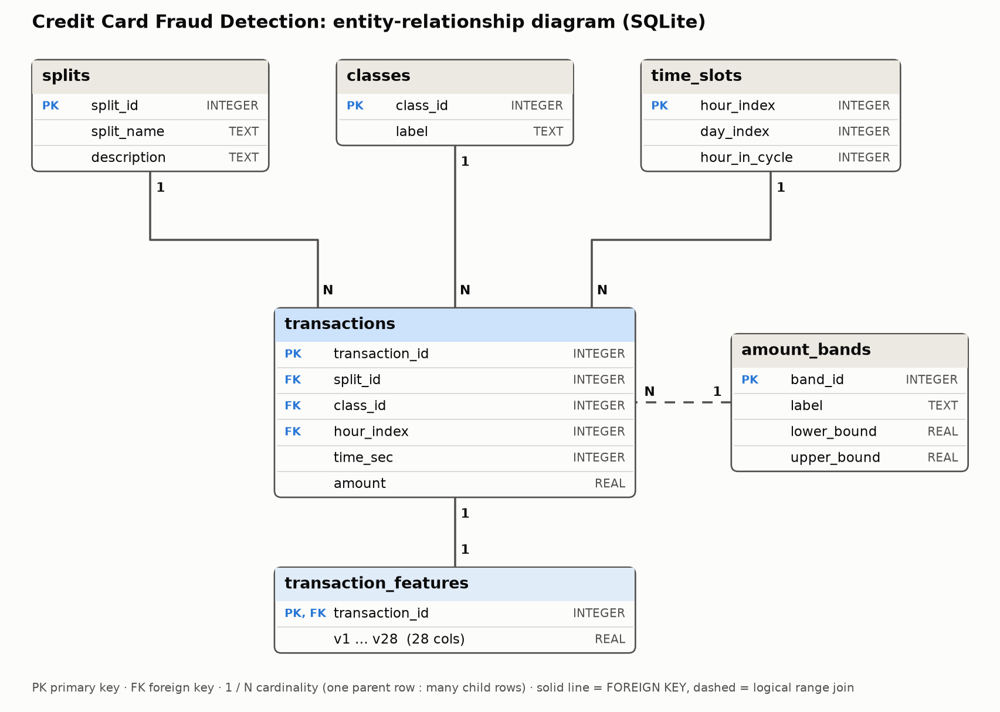

# Data Engineering & SQL: report section

**Author:** Zhandarbek Zhetpissov, group AAI-2606 · **Project 32:** Credit Card Fraud Detection

> This section is generated by `python -m src.data.cli summary` from the files in `reports/`
> (`data_audit.json`, `split_summary.json`, `benchmarks.json`, `eda/`, `sql_results/`).
> Every number below was computed from the dataset; none is typed by hand. The sections of the other
> team members (machine learning, evaluation and application) are added next to this one in the final report.

## 1. Data

The dataset is the ULB *Credit Card Fraud Detection* table: 284,807 transactions in 31 columns
(`Time`, `V1`–`V28`, `Amount`, `Class`). `V1`–`V28` are anonymised numerical features, `Time` is the number of seconds since the first
transaction, `Class` is 1 for fraud. The file spans 48.0 hours and contains 492 frauds, i.e. 0.1727 % of the rows
(about 578 legitimate transactions per fraud), so plain accuracy is not informative and the project uses PR-AUC,
recall at a fixed precision and threshold tuning.

The official source is Kaggle (`mlg-ulb/creditcardfraud`, login required). To keep the project reproducible without a login, the same file is
downloaded from a public mirror (`src/data/download.py`) and verified: header, 284,807 rows and 492 frauds must match.
SHA-256 of the file used: `76274b691b16a6c49d3f159c883398e03ccd6d1ee12d9d8ee38f4b4b98551a89`.

## 2. Data-quality audit

| Check | Result |
|---|---|
| Rows x columns | 284,807 x 31 |
| Missing values | 0 |
| Constant columns | none |
| Rows repeating an earlier row | 1,081 (19 fraud, 1,062 legitimate) |
| Time range | 0 - 172,792 s (48.00 h) |
| Rows ordered by Time | yes |
| Most rows sharing one timestamp | 36 |
| Amount: zero / negative | 1,825 / 0 |
| Amount: at most 2 decimals | yes |
| Amount outside IQR fences | 11.20 % (fences -101.75 .. 184.51) |
| Fraud share | 0.1727 % (492 of 284,807) |

What the audit means for the project:

- The table contains no missing values, so no imputation is needed.
- 1,081 rows repeat an earlier row (19 of them fraud, 1,062 legitimate) in 773 groups of identical rows.
  They are **kept**: removing them would change the dataset size and the row-based `transaction_id`; the effect on the models is for the ML module to judge.
- The rows are already ordered by `Time`, so the row position is also the chronological rank. Up to 36 rows share one timestamp.
- 1 Time value(s) are written in scientific notation (1e+05); pandas therefore reads the whole column as float64 although every value is a whole number of seconds.
- By the IQR rule 11.2 % of `Amount` values are outliers; the columns with the largest outlier share are V27 (13.8 %), Amount (11.2 %), V28 (10.7 %).
  The outliers are valid transactions (and some are frauds), so they are **kept**; whether to transform `Amount` (log, robust scaling) is left to the ML pipeline.

## 3. Memory optimisation and storage

The raw CSV is read as 30 `float64` columns and one `int64` column. The dtype policy (`src/data/memory.py`) is explicit and every cast is verified:
integer-valued columns are cast only if every value is a whole number inside the range of the new type, and `float32` is accepted only if the
relative error stays below 1e-6. `Amount` is deliberately kept as `float64` so that SQL sums equal the CSV.

| Column(s) | dtype before | dtype after | MiB before | MiB after | Values identical | Max relative error |
|---|---|---|---|---|---|---|
| Time | float64 | int32 | 2.17 | 1.09 | yes | 0.0e+00 |
| V1..V28 | float64 | float32 | 60.84 | 30.42 | no | 6.0e-08 |
| Amount | float64 | float64 | 2.17 | 2.17 | yes | - |
| Class | int64 | int8 | 2.17 | 0.27 | yes | - |

DataFrame memory: **67.4 MiB → 34.0 MiB (49.6 % smaller)**.

### Storage formats: baseline against alternatives

Five loading strategies were compared (`src/data/benchmark.py`). Each one runs in a fresh Python process so that its peak resident memory is its own;
times are the median of 3 runs on this machine (darwin).

| Variant | Load time, s | Speed-up vs baseline | DataFrame, MiB | Peak RSS above idle, MiB | Columns |
|---|---|---|---|---|---|
| csv_float64 | 0.095 | 1.0 | 67.4 | 305 | 31 |
| csv_chunked_optimized | 0.444 | 0.21 | 34.0 | 222 | 31 |
| parquet_float64 | 0.079 | 1.2 | 67.4 | 203 | 31 |
| parquet_optimized | 0.069 | 1.38 | 34.0 | 103 | 31 |
| parquet_optimized_3cols | 0.042 | 2.27 | 3.5 | 19 | 3 |

| File | Size, MiB |
|---|---|
| csv | 143.8 |
| parquet_float64_zstd | 72.7 |
| parquet_optimized_zstd | 43.4 |
| parquet_optimized_snappy | 46.4 |

- File size: the optimised Parquet file is 43.4 MiB against 143.8 MiB for the CSV (70 % smaller).
- Load time and peak memory above an idle interpreter: CSV baseline 0.095 s / 305 MiB; chunked CSV with per-chunk compression 0.444 s / 222 MiB;
  optimised Parquet 0.069 s / 103 MiB.
- Reading only three columns from Parquet (`Time`, `Amount`, `Class`) is 2.3x the speed of the baseline: columnar storage lets the reader skip unused columns.

## 4. Chronological split without leakage

Fraud patterns change over time and the model will score future transactions, so the split is chronological and deterministic (no random seed):
rows are ordered by `Time`; the first 70 % are `train`, the next 15 % `validation`, the last 15 % `test`. A cut is moved forward to the next distinct `Time`, so no
timestamp is shared between two splits. `transaction_id` is the 0-based row position in the CSV and never changes.

| Split | Rows | Share of rows | Frauds | Fraud rate | Time range, s | transaction_id range |
|---|---|---|---|---|---|---|
| train | 199,364 | 70.00 % | 384 | 0.193 % | 0 - 132,928 | 0 - 199,363 |
| validation | 42,722 | 15.00 % | 56 | 0.131 % | 132,929 - 151,328 | 199,364 - 242,085 |
| test | 42,721 | 15.00 % | 52 | 0.122 % | 151,329 - 172,792 | 242,086 - 284,806 |

- The fraud rate is 0.193 % in train, 0.131 % in validation and 0.122 % in test, so the class prior differs between the splits and PR-AUC values from different splits cannot be compared without remembering it.
- Validation and test contain only 56 and 52 frauds: precision and recall measured there will have wide uncertainty and the final report should say so.
- Rules that follow for the whole team: fit preprocessing, SMOTE or undersampling on train only; tune the threshold on validation only; use test once, at the end. `src/data/api.py` serves each split (`load_xy("train")`), and the committed `data/processed/split_manifest.parquet` is the shared `transaction_id → split` table.

## 5. Exploratory data analysis

Statistics that relate features to the target (correlations, amounts by class, discriminative features) are computed on the train split only, so EDA cannot leak
validation or test information into feature choices. Descriptive facts about the whole file (class balance, time profile) use all rows.

| Figure | File |
|---|---|
| Class balance | `reports/figures/eda_01_class_balance.png` |
| `Amount` by class: density and IQR boxplot (train) | `reports/figures/eda_02_amount_by_class.png` |
| Transactions and fraud rate by hour | `reports/figures/eda_03_time_profile.png` |
| Correlation of features with `Class` (train) | `reports/figures/eda_04_feature_target_correlation.png` |
| Correlation matrix (train) | `reports/figures/eda_05_correlation_heatmap.png` |
| Boxplots of the most discriminative features (train) | `reports/figures/eda_06_top_feature_boxplots.png` |
| Fraud rate per split | `reports/figures/eda_07_split_drift.png` |
| **Interactive** (Plotly): hourly profile, feature scatter | `reports/figures/eda_08_*.html`, `eda_09_*.html` |

Observations (all numbers are from the files in `reports/eda/`):

- Median `Amount` over all rows is 22.00 for legitimate and 9.25 for fraudulent transactions (means 88.29 and 122.21; maximum 25691.16).
- The largest absolute correlations with `Class` in train: V17 (-0.384), V14 (-0.326), V12 (-0.277), V10 (-0.256), V3 (-0.244), V7 (-0.238).
- `V1`–`V28` are almost uncorrelated with each other (mean |r| = 0.019, maximum 0.105), which is what one expects from principal components.
- The hour with the highest fraud rate is hour 26 since the first transaction: 2.05 % (36 frauds among 1,752 transactions). Hours with little traffic give noisy rates.

## 6. Database design (SQLite)

The data is stored in a normalised, star-like schema (`src/db/sql/schema.sql`); the ER diagram is generated from the database itself
(`python -m src.db.er_diagram`), so it cannot drift from the schema.

| Table | Role |
|---|---|
| `transactions` | one narrow row per transaction: `transaction_id` (PK), `split_id`, `class_id`, `hour_index` (FKs), `time_sec`, `amount` |
| `transaction_features` | the 28 V features, 1:1 with `transactions` (kept apart so analytical scans of `transactions` stay narrow) |
| `splits`, `classes`, `time_slots` | lookup / dimension tables referenced by foreign keys |
| `amount_bands` | business amount bands, joined by a range condition (`lower_bound <= amount < upper_bound`) |

Integrity is enforced by the database: primary and foreign keys, `NOT NULL`, `UNIQUE`, `CHECK` (class in {0, 1}, amount >= 0, hour in a 24-hour cycle) and `ON DELETE CASCADE` for features.
The loader builds the database in a temporary file, verifies it (row counts, sum of `Amount`, frauds per split, `PRAGMA foreign_key_check`, `PRAGMA integrity_check`) and only then moves it into place;
a failed build leaves no half-filled file.

The data has no absolute clock time, so `time_slots` stores `hour_index` (hours since the first transaction), `day_index` and `hour_in_cycle` (hour index modulo 24); it does not claim a time of day.

## 7. SQL analysis

13 queries (`src/db/sql/queries/`) answer concrete questions about the data; each file states its question, the constructs it uses and its scope in a header.
Every query is executed through SQLAlchemy and its result is loaded into a Pandas DataFrame (`pandas.read_sql_query`), then saved to `reports/sql_results/`.

| Query | Question | Constructs (detected in the SQL) |
|---|---|---|
| `q01_split_overview` | How many transactions and frauds does each split hold, and how much money is involved? | JOIN, GROUP BY |
| `q02_fraud_by_amount_band` | In which amount bands is fraud over- or under-represented? | JOIN, GROUP BY |
| `q03_hourly_fraud_hotspots` | Which hours since the first transaction have the highest fraud rate, ignoring hours with little traffic? | JOIN, GROUP BY, HAVING |
| `q04_hours_above_average_fraud_rate` | In how many hours is the fraud rate above the dataset-wide average, and by what factor? | JOIN, GROUP BY, HAVING, subquery |
| `q05_rolling_fraud_rate` | How does fraud intensity move over time once single noisy hours are smoothed? | GROUP BY, CTE (WITH), window function (OVER) |
| `q06_fraud_pareto_by_hour` | How many hours account for half of all frauds? | GROUP BY, CTE (WITH), window function (OVER) |
| `q07_fraud_rate_by_amount_decile` | Does fraud concentrate in the low or high end of the amount distribution? | JOIN, GROUP BY, CTE (WITH), window function (OVER) |
| `q08_time_between_frauds` | How bursty is fraud: how long is the typical wait from one fraud to the next? | JOIN, GROUP BY, CTE (WITH), window function (OVER) |
| `q09_top_fraud_amounts_per_split` | Which are the three biggest frauds per split and when did they happen? | JOIN, CTE (WITH), window function (OVER) |
| `q10_class_feature_moments` | Which anonymised features separate fraud from legitimate transactions? | JOIN, GROUP BY |
| `q11_integrity_anti_joins` | Are there transactions without features, features without transactions, or unused dimension rows? | JOIN, subquery |
| `q12_duplicate_transactions` | How many rows repeat an earlier row, in which classes, and in groups of what size? | JOIN, GROUP BY, HAVING, CTE (WITH) |
| `q13_day_comparison` | Does the hourly fraud pattern repeat from the first 24 hours to the second 24 hours? | JOIN, GROUP BY, CTE (WITH) |

Coverage of the required constructs, detected automatically from the SQL text:

| Required construct | Queries using it | Examples |
|---|---|---|
| JOIN | 11 | q01_split_overview, q02_fraud_by_amount_band, q03_hourly_fraud_hotspots |
| GROUP BY | 11 | q01_split_overview, q02_fraud_by_amount_band, q03_hourly_fraud_hotspots |
| HAVING | 3 | q03_hourly_fraud_hotspots, q04_hours_above_average_fraud_rate, q12_duplicate_transactions |
| CTE (WITH) | 7 | q05_rolling_fraud_rate, q06_fraud_pareto_by_hour, q07_fraud_rate_by_amount_decile |
| subquery | 2 | q04_hours_above_average_fraud_rate, q11_integrity_anti_joins |
| window function (OVER) | 5 | q05_rolling_fraud_rate, q06_fraud_pareto_by_hour, q07_fraud_rate_by_amount_decile |

Findings (computed from the query results; they describe the data, they do not explain it):

- Amounts in the lowest decile of the train split (0.00 - 1.00) hold 138 of the 384 train frauds (35.9 %); the fraud rate there is 0.69 % against 0.19 % for the whole split (`q07`).
- Transactions with Amount = 0 have a fraud rate of 1.31 % (18 of 1,379 in train) (`q02`).
- 12 of 48 hours contain at least half of all frauds (`q06`).
- The highest hourly fraud rate among hours with enough traffic is 2.05 % in hour 26 (36 frauds in 1,752 transactions) (`q03`); 18 hours are above the overall rate (`q04`).
- Mean gap between consecutive frauds: train 345 s, validation 324 s, test 361 s (`q08`).
- 1,081 rows repeat an earlier row (`q12`); this equals the 1,081 found by the Pandas audit on the raw CSV.
- Features with the largest standardised mean difference between fraud and legitimate rows (train): V14 (-2.29), V4 (+2.02), V12 (-1.97), V11 (+1.94), V10 (-1.70), V16 (-1.63) (`q10`).

## 8. Pandas against SQL

The same four tasks were solved in Pandas (from Parquet) and in SQL (SQLite); the benchmark aborts unless both give the same answer. Times are the median of 5 runs with warm caches on one machine.

| Task | Pandas from Parquet, s | Pandas in memory, s | SQLite via SQLAlchemy, s | Same answer |
|---|---|---|---|---|
| hourly counts (GROUP BY) | 0.008 | 0.005 | 0.024 | yes |
| split overview (JOIN + GROUP BY) | 0.031 | 0.026 | 0.06 | yes |
| 3-hour rolling rate (CTE + window) | 0.007 | 0.004 | 0.025 | yes |
| exact duplicates over 30 columns (GROUP BY ... HAVING) | 0.306 | 0.282 | 1.523 | yes |

Pandas on columnar Parquet was faster than SQLite in all 4 tasks (SQL took 2.0x - 5.0x as long end-to-end). SQL is not chosen for speed here: it gives declarative queries, enforced integrity, indexes, and the possibility to join the model predictions of the ML module back to transactions without loading everything into memory.

## 9. Verification and reproducibility

- **SQL is cross-checked against Pandas.** 8 queries (`q01`, `q02`, `q05`, `q07`, `q08`, `q10`, `q11`, `q12`) are recomputed independently in Pandas from the Parquet file and compared; the pipeline stops if one differs (`src/db/crosscheck.py`). For example the duplicate count found in SQL equals the count found by the audit on the raw CSV.
- **Tests:** `python -m pytest tests/data_engineering` (synthetic data for unit tests, plus integration checks on the real dataset when it has been built).
- **One command rebuilds everything:** `python -m src.data.cli run-all`; the console menu is `python -m src.data.cli`. The split and all statistics are deterministic; the only random choice (a plot sample) uses a fixed seed.
- **Versions** of the libraries are pinned in `requirements-data.txt`.

## 10. Limitations

- The file was downloaded from a public mirror, not from Kaggle; its SHA-256 is recorded so any other copy can be compared, and the row and fraud counts match the official description.
- Validation and test contain few frauds (56 and 52); the chronological split is the correct protocol but gives noisy estimates.
- The V features are anonymised, so EDA can show *that* features separate the classes but not *why*.
- The data has no absolute clock time; time-of-day statements are not possible.
- Benchmarks were measured on one machine (darwin) in warm-cache conditions; read them as relative comparisons.
- Duplicate rows and outliers are reported and kept, not removed; the ML module decides how to treat them.

## 11. Contribution of the author

Zhetpissov Zhandarbek (Data Engineering & SQL): download and verification of the data, audit, memory optimisation and Parquet, chunked loading, the stable `transaction_id` and the chronological split with its tests,
the read API for the other modules, EDA with static and interactive figures, the normalised SQLite schema and loader, the generated ER diagram, 13 SQL queries with the SQL-to-Pandas runner and cross-checks,
the CSV/Parquet and Pandas/SQL benchmarks, the console menu, and the data contract document (`docs/CONTRACTS.md`).

<!-- Dias Zakir (Machine Learning): contribution to be added by Dias. -->
<!-- Adam Satyshev (Evaluation & Application): contribution to be added by Adam. -->
